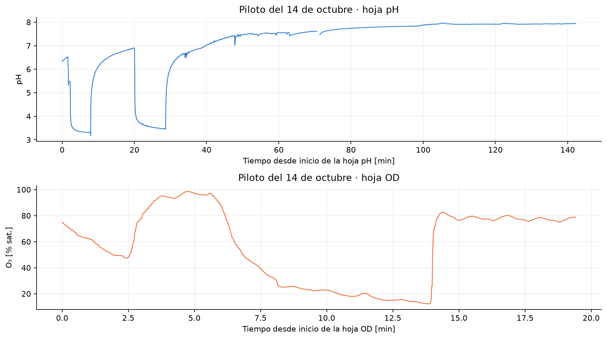
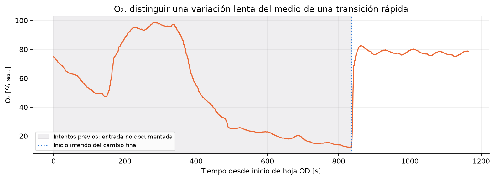
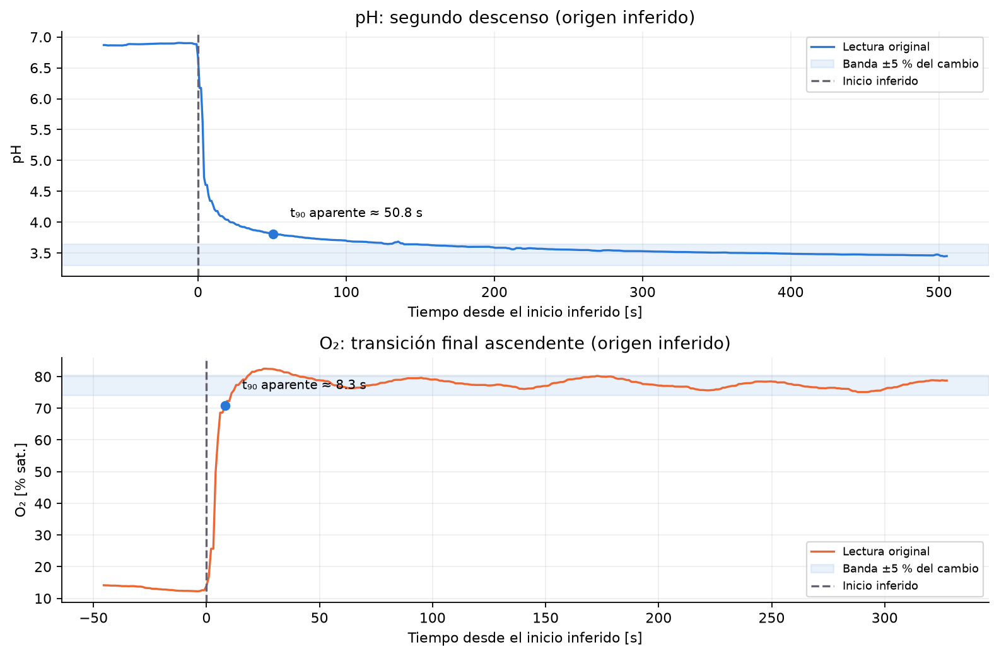

## A. Preparación del taller

Preparar los cuatro medios y verificar las dos sondas con anticipación. La llegada del nitrógeno no debe ser parte del tiempo de 45 minutos. Probar burbujeo, mezcla, temperatura y adquisición. Tener etiquetas, fichas, calculadora y acceso al registro exportado. Confirmar que las salidas automáticas estén en un estado seguro.

Los participantes deben identificar las sondas por sí mismos. Dejar accesibles las etiquetas y documentos existentes; no proporcionarles un modelo supuesto. Si no es posible identificar la tecnología, el informe puede quedar con “no disponible”, pero debe conservar un ID que permita reconocer la sonda ensayada.

Los buffers **pH 3 y pH 10** corresponden al montaje confirmado para el taller. No están confirmados los valores nominales de los buffers del piloto. La lectura histórica no demuestra por sí sola qué buffer se usó.

## Presentación del modelo de primer orden

Mostrar el esquema de respuesta gradual y presentar primero el cambio total entre las dos mesetas. Explicar después la ecuación de primer orden: la señal cambia más rápido cuando está lejos del valor final y se hace más lenta al acercarse. Sustituir un tiempo transcurrido igual a τ en la solución para obtener 1 − e⁻¹ ≈ 0.632. Relacionar luego el 90 % con 2.303 τ y volver a la lectura directa de t₉₀ en la curva experimental. La derivación sirve para entender el modelo; no es un requisito de cálculo diferencial para participar.

Separar el retraso puro de la constante de tiempo. El t₁₀ es un umbral observable y no mide por sí solo ese retraso. Los valores históricos del piloto son aparentes y no demuestran que las sondas sigan un modelo de primer orden; no convertirlos automáticamente a τ.

## B. Registro experimental del 14 de octubre de 2026

`B2 Respuesta electrodos.xlsx` contiene las hojas **pH** y **OD**, con registros independientes. No sumar sus tiempos ni asumir continuidad entre ellas. La hoja pH abarca unos 142 min y la hoja OD unos 19 min. El intervalo mediano es aproximadamente **1.01 s**.

Se utiliza `ProcessTime`, expresado originalmente en horas, para reconstruir el tiempo transcurrido con resolución subsegundo. Hay marcas de reloj repetidas al final de las hojas. En pH también hay 15 filas con señales faltantes, cinco puntos con ambas señales en cero y un intervalo de unos 17 s sin muestreo; los ceros simultáneos se marcan como posibles artefactos y no se interpretan como transferencias. Los originales se conservan en el Excel.

El archivo no registra eventos de inmersión, gases, agitación, temperatura de los vasos, identidad de buffers ni modelo/serie de sondas. El setpoint de pH que aparece en la hoja pH no identifica la solución del vaso. Por eso **no permite obtener tiempos intrínsecos certificados** ni verificar todo el procedimiento propuesto.

## C. Selección e interpretación de los registros

| Tramo observado | Lectura de los datos | Uso en la enseñanza |
|---|---|---|
| pH, primer descenso (aprox. 95–160 s) | Cambio en varias etapas antes de acercarse a pH 3.3. | Mostrar por qué una transferencia o entrada mal definida impide fijar un t₀ confiable. |
| pH, segundo descenso (aprox. 1204 s) | Lectura de alrededor de 6.89 hacia 3.47, con una cola lenta. | Ejemplo exploratorio de t₉₀ y estabilización, declarando el inicio inferido. |
| pH, ascensos y registro prolongado | Recuperación lenta y deriva; la señal acaba cerca de 7.9 mucho después. | Discutir arrastre, acondicionamiento, cambios de medio y temperatura como posibilidades, no diagnósticos demostrados. |
| OD, antes de aprox. 836 s | Descensos lentos y variaciones con condiciones de entrada desconocidas. | No atribuirlos automáticamente al tiempo de la sonda ni a un ensayo aire → N₂ bien ejecutado. |
| OD, transición final ascendente | Paso rápido de alrededor de 12.6 a 77.2 % de saturación, con oscilación posterior. | Es el ejemplo más claro para visualizar una respuesta rápida; compatible con pasar de un medio de O₂ bajo a otro mayor. |

Según el relato de la sesión, el N₂ solo estuvo disponible al final. Esto ayuda a contextualizar el ensayo, pero el archivo **no marca el momento de su uso**. La transición final es ascendente: no presentarla como un descenso aire → N₂ ni como una medición independiente de los dos sentidos.

## D. Ejemplos cuantitativos exploratorios

Los inicios de esta tabla se **infieren de las curvas**, no de una marca de transferencia. Se fijaron en 1204.15 s para el segundo descenso de pH y 836.25 s para el cambio final de OD, medidos desde el inicio de cada hoja. Los decimales localizan la muestra usada: no representan exactitud del evento físico.

| Ventana ilustrativa | Lectura inicial → final | t₉₀ aparente [s] | t₁₀–₉₀ [s] | Estabilización aparente [s] |
|---|---|---|---|---|
| pH, segundo descenso | 6.89 → 3.47 | 50.8 | 50.6 | 149.2 |
| OD, cambio final ascendente | 12.64 → 77.22 % | 8.3 | 7.0 | 40.5 |

La estimación usa medianas en ventanas especificadas en `ventanas_piloto.json` para reducir la influencia de valores aislados; el cálculo manual del taller usa promedios de mesetas. Los cruces se interpolan linealmente sin filtrar la señal. La banda es ±5 % del cambio y se exige al menos 30 s dentro de ella y permanencia hasta el final de la ventana. Ver las ventanas, calidad y métricas completas en `resultados/piloto.json`.

Estos números dependen del origen inferido, de los niveles elegidos y de la duración de observación. **No son metas que los equipos deban reproducir.** En particular, el descenso lento previo de OD no es una segunda medición válida de la respuesta inversa. Un registro nuevo con t₀ marcado y medios preparados es el resultado principal del taller.

## E. Revisión de las condiciones de ensayo

| Si ocurre esto | Qué revisar o hacer |
|---|---|
| El medio con N₂ sigue bajando | Prepararlo antes y comprobar meseta; no medir la respuesta mientras el vaso se desoxigena. Si no se logra, declarar montaje no preparado. |
| El nivel bajo de O₂ queda lejos de cero | Revisar purga, entrada de aire, burbujas, calibración y tiempo de preparación. No forzar el cero ni recalibrar a mitad del ensayo para “corregir” la curva. |
| La señal cambia por etapas | Revisar tránsito, contacto con otros líquidos, profundidad y burbujas; marcar incidentes. No elegir retrospectivamente el comienzo más conveniente. |
| El pH deriva sin meseta | Revisar temperatura, buffer, arrastre, hidratación y referencia con el manual de la sonda. No sustituir una meseta ausente por el último dato. |
| La respuesta parece instantánea | Comprobar intervalo de adquisición y filtrado. Si ocurre entre dos muestras, reportar que no se resuelve con ese registro. |
| t₉₀ se alcanza, pero la lectura sigue oscilando | Separar cruce del 90 % y estabilización. Revisar mezcla y burbujas; no suavizar retrospectivamente para conseguir una cifra menor. |
| Falta el modelo o el manual | Conservar ID temporal, condiciones y “no disponible”. Comparar sistemas tal como se ensayaron sin exigir un tiempo de ficha técnica. |

Si no se consiguen las condiciones de O₂, usar el registro histórico como análisis de datos y declarar que no hubo una medición nueva válida. No presentar un cambio de gas en un solo vaso como equivalente al protocolo de transferencia.

# Alcance del tiempo de respuesta medido

El resultado incluye la **sonda, la película de líquido junto a ella, el procedimiento de transferencia y la adquisición/filtrado de Biostat**. Es un tiempo de respuesta observado del sistema de medición en las condiciones registradas. Una comparación con un fabricante requiere identificar modelo, tecnología, definición del tiempo (t₉₀, t₉₈, etc.), temperatura y condiciones de su ensayo.

Referencias de preparación de Hamilton: [respuesta de pH](https://www.hamiltoncompany.com/knowledge-base/article/response-time) y [referencias de oxígeno](https://www.hamiltoncompany.com/knowledge-base/article/do-sensor-calibration). No identifican las sondas del taller ni sustituyen sus manuales.
