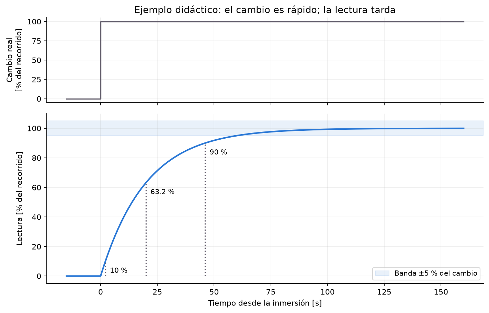
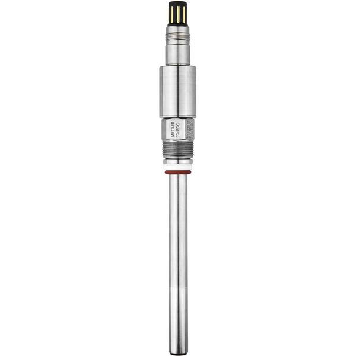
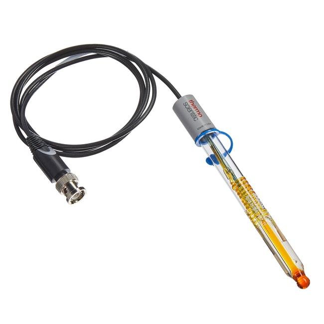
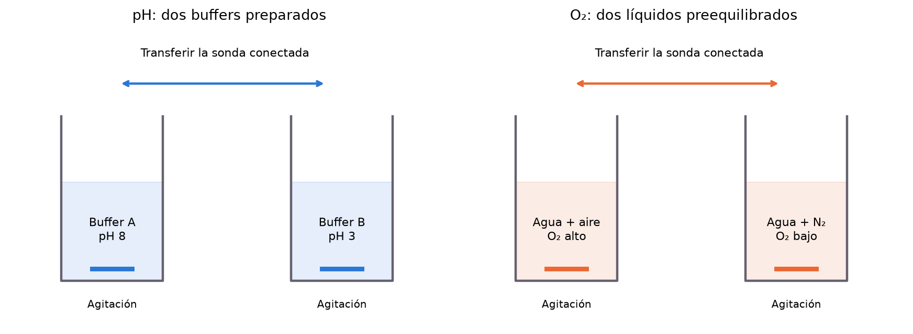

**Taller:** Caracterización de sensores para bioprocesos

**Duración:** máximo 45 min por equipo; 3 equipos de 6 personas, de forma sucesiva.

**Equipo:** sondas conectadas a Biostat, dos buffers de pH y dos soluciones con diferente contenido de oxígeno.

# 1. Respuesta dinámica de los sensores

En un cultivo, el pH y el oxígeno disuelto influyen en el entorno de las células. Para conocerlos usamos sensores, pero su lectura no cambia de manera instantánea cuando cambia el medio. La sonda necesita tiempo para responder y el equipo puede añadir procesamiento o filtrado a la señal.

**Calibrar y medir el tiempo de respuesta son tareas distintas.** La calibración relaciona la señal con valores conocidos. La prueba de respuesta observa cuánto tarda la lectura en reflejar un cambio. Una sonda puede estar calibrada y responder lentamente.

# 2. Conceptos fundamentales

## 2.1. Tiempo de respuesta

El tiempo de respuesta es el intervalo que necesita un sensor para registrar un cambio de una variable hasta alcanzar un porcentaje especificado de su cambio total.

En instrumentación de procesos se utiliza habitualmente el tiempo de respuesta del 90 %, t₉₀, definido como el tiempo que tarda la lectura en completar el 90 % del cambio entre su valor inicial y su valor final.

Si el cambio total es de 0 a 100 %, el t₉₀ es el tiempo en que la lectura llega a 90 % del cambio total. La curva es ilustrativa y no representa datos de un electrodo específico.

Para cualquier variable X, la respuesta normalizada puede expresarse como:

$$R(t)=\frac{X(t)-X_0}{X_f-X_0}\times100$$

Donde:

- $X_0$: lectura inicial estable.
- $X_f$: lectura final estable.
- $X(t)$: lectura en el instante t.

El tiempo de respuesta t₉₀ corresponde al primer instante en que $R(t)=90\,\%$.

Esta definición funciona tanto para aumentos como para disminuciones, siempre que el cambio total sea distinto de cero.

## 2.2. Modelo de primer orden

Muchos sensores pueden aproximarse mediante un modelo de primer orden:

$$X(t)=X_f+(X_0-X_f)e^{-t/\tau}$$

Donde τ es la constante de tiempo del sensor. En esta expresión, t es el tiempo transcurrido desde el cambio, con t = 0 al completar la inmersión en el medio de destino; se supone una respuesta sin retraso puro.

Para este modelo:

$$t_{90}=2.303\,\tau$$

También se cumple aproximadamente:

- $t_{63.2}=\tau$.
- $t_{90}=2.303\,\tau$.
- $t_{95}\approx3\,\tau$.
- $t_{99}\approx4.605\,\tau$.

Estas relaciones son válidas para una respuesta exponencial de primer orden. Los sensores reales pueden presentar retrasos, múltiples constantes de tiempo o limitaciones por el sistema de adquisición.

### Constante de tiempo y origen del 63.2 %

El modelo corresponde a la ecuación diferencial $\tau\,dX/dt+X=X_f$, de primer orden porque contiene la primera derivada de la lectura respecto al tiempo. τ tiene unidades de tiempo; una τ menor indica una respuesta más rápida.

Al sustituir la solución exponencial en la respuesta normalizada:

$$R(t)=\left(1-e^{-t/\tau}\right)\times100$$

Cuando t = τ, el exponente vale −1 y se obtiene:

$$R(\tau)=\left(1-e^{-1}\right)\times100\approx63.2\,\%$$

El 63.2 % corresponde al recorrido entre la lectura inicial y final, no necesariamente a una lectura de 63.2 % de saturación. Si existe un retraso puro L, el tiempo al 63.2 % contado desde la inmersión es aproximadamente $L+\tau$ y el t₉₀ es $L+2.303\,\tau$. En ese caso no se obtiene τ dividiendo directamente el t₉₀ observado entre 2.303.

# 3. Diferencias entre los sensores de oxígeno disuelto y pH

## Sensor de oxígeno disuelto

Mide la concentración de oxígeno o el porcentaje de saturación. Los sensores ópticos utilizan luminiscencia, mientras que los electroquímicos consumen oxígeno en su superficie. La respuesta depende del diseño, la membrana cuando existe, la temperatura, el movimiento del líquido y el estado del sensor.

## Electrodo de pH

Es habitualmente un electrodo combinado de vidrio con referencia. Su respuesta depende de la hidratación de la membrana de vidrio, el estado de la unión de referencia, la temperatura, la composición de la solución y el equipo de medición.

Una distinción esencial para el curso es que el tiempo observado al cambiar una sonda de recipiente incluye no solo la respuesta del sensor, sino también el tiempo de transferencia, la mezcla local y la frecuencia de adquisición. En esta práctica se medirá el tiempo de respuesta operacional del conjunto sonda–transmisor, que es el más relevante para el usuario del biorreactor.

{width=6cm} {width=6cm}

Sonda de oxígeno disuelto (izquierda) y electrodo de pH (derecha). Imágenes de la versión de OTR; se muestran como referencia de los sensores, sin identificar los utilizados en el taller.

# 4. Objetivo y organización

Al finalizar, los participantes podrán definir t₉₀ y τ, explicar el origen del 63.2 % en un modelo de primer orden, distinguir la respuesta de la sonda de la del sistema completo y relacionar una lectura lenta con el control del cultivo.

**Objetivo:** identificar las sondas utilizadas y determinar t₁₀, t₉₀ y el tiempo de estabilización de las lecturas de pH y O₂, en ambos sentidos de transferencia. Comparar los resultados considerando temperatura, agitación, registro y condiciones de cada ensayo.

Cada uno de los tres equipos realiza las dos pruebas. Al cambiar de sensor, intercambiar los roles para que todos participen en la operación y el análisis. Las seis personas se reparten estos roles:

1. **Identificación y trazabilidad:** lee etiquetas y llena la ficha de sensores, soluciones y condiciones.
2. **Operación:** transfiere la sonda con ayuda del instructor, sin desconectarla.
3. **Tiempo:** marca cada inmersión y registra la hora exacta de t₀.
4. **Adquisición:** comprueba el registro digital, la señal y las unidades; respalda las observaciones manuales.
5. **Gráfica y cálculo:** localiza niveles inicial/final y cruces del 10 y 90 %.
6. **Verificación y comparación:** revisa las cuentas, la permanencia en banda y la tabla de resultados.

## Condiciones de ensayo y variables registradas

Mantendremos dos ambientes preparados y moveremos la sonda rápidamente de uno a otro. La transferencia debe ser breve, pero cuidadosa: “de golpe” significa cambiar el medio en poco tiempo, no golpear el sensor.

| Sensor | Medio inicial y final | Señal que registramos |
|---|---|---|
| pH | Buffer **pH 3 → pH 10**, después **pH 10 → pH 3** | pH indicado por Biostat |
| Oxígeno disuelto (O₂, OD o pO₂) | Agua equilibrada con **aire → agua con N₂**, después el sentido inverso | Oxígeno en % de saturación indicado por Biostat |

En pH medimos la respuesta de un electrodo. En oxígeno registraremos la identificación de la sonda sin suponer su tecnología. Biostat es el equipo que recibe y muestra la señal; no necesariamente es el fabricante de la sonda.

## Parámetros adicionales del taller

| Medida | Qué significa en esta práctica |
|---|---|
| **Inicio observable: t₁₀** | Tiempo desde la inmersión hasta recorrer el 10 % del cambio total. Es un umbral práctico; puede haber cambios menores antes. |
| **Tiempo de respuesta: t₉₀** | Tiempo desde la inmersión hasta recorrer por primera vez el 90 % del cambio. |
| **Tiempo de estabilización** | Primer instante en que la lectura entra en una banda alrededor del valor final y permanece allí al menos 30 s y hasta terminar el registro de ese ensayo. |

También calcularemos **t₁₀–₉₀ = t₉₀ − t₁₀**: cuánto tarda la parte central de la transición. Es útil para comparar curvas, pero no incluye todo el retraso desde la inmersión.

## Cálculo de los umbrales de respuesta

En los cálculos y las hojas de datos, y₀, y_f e y(t) representan las mismas lecturas que X₀, Xf y X(t) en las ecuaciones anteriores.

Llamaremos **y₀** a la lectura estable antes de transferir, **y_f** a la lectura final estable y **t₀** al instante en que la parte sensible queda sumergida en el líquido de destino. El tiempo transcurrido se cuenta desde t₀, no desde que empieza a moverse la pantalla.

$$y_{90} = y_0 + 0.90\,(y_f-y_0)$$

Para el 10 % se hace la misma cuenta sustituyendo 0.90 por 0.10. La resta $y_f-y_0$ puede ser negativa: la fórmula sirve tanto al subir como al bajar.

| Ejemplo didáctico | Cambio | Nivel al 10 % | Nivel al 90 % |
|---|---|---|---|
| pH: 3 a 10 | 10 − 3 = 7 | 3 + 0.7 = **3.7** | 3 + 6.3 = **9.3** |
| pH: 10 a 3 | 3 − 10 = −7 | **9.3** | **3.7** |
| O₂: 100 a 0 % | 0 − 100 = −100 puntos | **90 % de saturación** | **10 % de saturación** |

**Atención:** recorrer el 90 % de un descenso de oxígeno no significa llegar a 90 % de saturación. Usa las lecturas estables observadas: si los extremos son 80 y 12 %, el nivel al 90 % es $80 + 0.90(12-80) = 18.8$ % de saturación.

El pH es una escala logarítmica. Aquí describimos el porcentaje del recorrido de la **lectura de pH**, no el porcentaje de cambio de la concentración de iones hidrógeno.

## Banda de estabilización

Usaremos una banda de **±5 % del cambio total** alrededor de y_f:

$$b = 0.05\,|y_f-y_0|\qquad\text{banda: de }y_f-b\text{ a }y_f+b$$

Las barras indican tomar el tamaño del cambio sin su signo. Para una lectura de pH de 3 a 10, b = 0.35 unidades y la banda es 9.65–10.35. Para oxígeno de 80 a 12 %, b = 3.4 puntos y la banda es 8.6–15.4 % de saturación.

Esta banda es un criterio didáctico común para comparar ensayos; no es un criterio universal del fabricante. **Entrar una vez no basta:** si sale de la banda después, buscar una entrada posterior. Si no permanece dentro, escribir “no se estabilizó durante el tiempo observado”.

# 5. Montaje y preparación

## Montaje para pH

Dos vasos identificados con **buffer pH 3** y **buffer pH 10**, a temperatura semejante y con agitación magnética suave y reproducible. Registrar el valor nominal, temperatura de referencia, lote o identificación y temperatura de uso. Usar volumen suficiente para cubrir la parte sensible y la unión de referencia, según la sonda.

Mantener los buffers separados y usar alícuotas frescas y volumen suficiente para reducir contaminación por arrastre. Antes de establecer la lectura inicial, acondicionar o enjuagar la sonda según su manual. **Durante la transferencia cronometrada no hacer un enjuague intermedio:** podría iniciar la respuesta antes del contacto con el vaso de destino. Dejar escurrir brevemente, sin frotar ni secar el bulbo, y transferir directamente con la misma técnica en ambos sentidos. Registrar el tiempo fuera de los vasos. La película de líquido arrastrada forma parte de las limitaciones del ensayo.

## Montaje para O₂

Dos vasos con agua de la misma procedencia y a temperatura semejante. **Cada vaso debe tener agitación magnética y burbujeo continuo:** uno con aire y otro con nitrógeno (N₂). Prepararlos antes de que llegue el equipo. Mantener condiciones constantes durante los ensayos y registrar caudal si puede medirse, o ajuste y tipo de burbujeo si no.

El aire busca un nivel alto de oxígeno; el N₂ desplaza el oxígeno y busca uno bajo. No asumir que las lecturas serán exactamente 100 y 0 %. Comprobar que cada medio tiene una meseta antes de medir. Evitar burbujas adheridas a la punta, contacto con la barra magnética y cambios de profundidad.

**La prueba consiste en cambiar de vaso, no en cambiar de gas dentro del mismo vaso.** Si se empieza a burbujear N₂ justo al transferir, también se mide la desoxigenación del líquido y no se puede separar la respuesta de la sonda. No trasladar el valor de 0.5 vvm del taller de control a este montaje: aquí los caudales se registran por vaso y se eligen para mantener las condiciones preparadas.

El instructor maneja cilindros y reguladores. Usar N₂ en un espacio ventilado, mantener los recipientes con salida de gas y no presurizarlos; el nitrógeno puede desplazar el oxígeno del ambiente.

## Registro y estado del equipo

Antes del taller, el instructor comprueba hidratación y condición de la sonda de pH, calibración disponible y acondicionamiento del sensor de O₂ según su modelo. Algunas sondas electroquímicas requieren polarización; no asumir que eso aplica a todas. Registrar el filtrado o amortiguamiento de Biostat si puede consultarse.

Desactivar con el instructor cualquier actuación automática ligada a las sondas (bombas de ácido/base, gases o cascadas). Aquí **Biostat se usa para registrar**, no para controlar el pH u O₂ de los vasos. Mantener el filtrado igual en todos los ensayos.

Usar adquisición digital con el menor intervalo disponible, **idealmente 1 s o menos**, y confirmar el intervalo real al exportar. Una respuesta de pocos segundos no puede resolverse bien con lecturas cada 10 s. La hoja manual sirve de respaldo, no sustituye un registro rápido.

# 6. Identificación de las sondas

Antes de transferir, el equipo localiza las etiquetas, las compara con el canal de pantalla y llena la ficha de la sección 9. **No desconectar ni desmontar la sonda para buscar datos.** Si la etiqueta no es accesible, consultar la documentación disponible o al instructor y anotar su origen.

Registrar fabricante, modelo, serie o ID de laboratorio y principio de medición cuando esté indicado. Añadir el estado visible y los datos de calibración disponibles. Si algo no se conoce, escribir **“no disponible”**, no completarlo por apariencia. Si no hay serie visible, asignar un ID temporal que identifique esa sonda durante el taller.

Esta información es parte del resultado: dos sensores con la misma variable medida pueden tener tecnologías, condiciones o ajustes diferentes. Un tiempo sin identificación y condiciones no puede compararse de manera confiable.

# 7. Procedimiento (máximo 45 min por equipo)

| Minutos | Actividad |
|---|---|
| 0–5 | Explicación de las medidas y reparto de roles. |
| 5–9 | Identificar ambas sondas, llenar sus fichas y verificar registro, soluciones y temperatura. |
| 9–20 | pH: lectura inicial en pH 3, transferencia a pH 10 y regreso a pH 3. Marcar t₀ en cada transferencia. |
| 20–22 | Comprobar los dos medios de O₂ y las condiciones de agitación y burbujeo. |
| 22–33 | O₂: aire → N₂ y N₂ → aire. Marcar t₀ y registrar cada transición. |
| 33–41 | Obtener niveles, calcular umbrales y leer tiempos en las gráficas. |
| 41–45 | Completar resultados, discutir límites y entregar el montaje al instructor. |

## Procedimiento de transferencia y registro

1. **Antes:** registrar una meseta inicial durante al menos 30 s. Como comprobación operativa, buscar un rango máximo de 0.05 unidades de pH o 2 puntos de O₂ en esos 30 s, sin tendencia evidente. Si no se cumple, estabilizar el montaje; son criterios del taller, no especificaciones de la sonda.
2. **Transferir:** mantener la conexión y minimizar el tránsito, sin un enjuague intermedio en el ensayo cronometrado. El cronometrista marca t₀ al completar la inmersión de la parte sensible en el destino. Registrar duración de transferencia y cualquier incidente.
3. **Observar:** mantener agitación, gas, profundidad y temperatura. Registrar aproximadamente 3–4 min por transición o hasta contar con una meseta final y confirmar 30 s dentro de la banda. No terminar al primer cruce del 90 %.
4. **Definir el final:** si hay una meseta sin tendencia evidente, usar como y_f el promedio de sus últimos 30 s. Comprobar la estabilidad con el mismo criterio del paso 1. Usar las lecturas medidas y no reemplazarlas por el pH nominal o un 0/100 % supuesto.
5. **Calcular:** promediar los 30 s iniciales para y₀, obtener y₁₀, y₉₀ y la banda final. Leer los instantes de cruce y restar t₀. Si el cruce queda entre dos muestras, reportar el intervalo o interpolar linealmente, indicando que se hizo.
6. **Comprobar la estabilización:** buscar la primera entrada que permanezca en banda hasta el fin del registro, con al menos 30 s de observación posterior. Anotar duración total. Al regresar, repetir como un ensayo nuevo, con su propio t₀ y sus propios niveles.

Si faltan mesetas, no fijar un y_f arbitrario. Registrar **“ensayo incompleto: no hay meseta final”** y la duración observada; no calcular t₉₀ usando la última lectura como si fuera el equilibrio. Si falta tiempo, trabajar el cálculo con el ejemplo o con el piloto, identificando la procedencia. No sustituir una dirección no ensayada por la otra.

## Cálculo de t₉₀ por interpolación lineal

Si el umbral $y_{90}$ queda entre dos lecturas consecutivas $y_1$ y $y_2$, tomadas a las horas $T_1$ y $T_2$ del archivo, podemos estimar la hora del cruce y restar la hora de inmersión:

$$T_{90}=T_1+\frac{y_{90}-y_1}{y_2-y_1}(T_2-T_1),\qquad t_{90}=T_{90}-t_0$$

Usar tiempos en una misma unidad, por ejemplo segundos desde el comienzo del archivo. La fórmula funciona al subir y al bajar, con $y_1\ne y_2$ y un umbral comprendido entre ambas lecturas. Elegir el primer cruce tras t₀; no interpolar sobre datos faltantes ni huecos del registro.

**Ejemplo de O₂ ascendente:** si las mesetas son 10 y 90 % de saturación, $y_{90}=10+0.90(90-10)=82$ %. Si a los 7 y 8 s desde t₀ se leen 80 y 84 %, el cruce estimado es $7+(82-80)/(84-80)=7.5$ s. El umbral es 82 % de saturación y t₉₀ es 7.5 s.

La interpolación permite estimar entre muestras; no mejora la exactitud del reloj ni sustituye una adquisición rápida. Indicar que se interpoló y conservar el intervalo entre muestras que encierra el cruce.

# 8. Comparación y discusión

En un cultivo celular, una sonda lenta entrega información atrasada al controlador. Si el ajuste del control es agresivo, ese retraso puede contribuir a oscilaciones. El tiempo de respuesta del lazo completo incluye además al controlador, las válvulas, las bombas y la dinámica del biorreactor; no equivale al t₉₀ medido aquí.

1. ¿Qué identificadores permiten reconocer cada sonda? ¿Qué información quedó pendiente y cómo podría verificarse?
2. ¿La primera señal de cambio, t₉₀ y la estabilización dieron el mismo tiempo? ¿Por qué pueden diferir?
3. ¿Fue igual ir de pH 3 a 10 que regresar? ¿Qué efecto pudieron tener el arrastre, el acondicionamiento y la temperatura?
4. ¿Por qué cambiar el gas en un mismo vaso no equivale a transferir entre dos medios preequilibrados?
5. ¿Qué parte de la respuesta puede venir de la sonda, del líquido, del tránsito y del filtrado de Biostat?
6. Si el registro es cada 1 s y una transición dura unos 8 s, ¿cuántos puntos la describen? ¿Qué pasaría al registrar cada 10 s?
7. ¿Se puede concluir que una sonda es mejor solo por ser más rápida? Considerar estabilidad, exactitud y aplicación.
8. ¿Por qué aparece el 63.2 % al transcurrir una τ? ¿En qué condiciones t₉₀ ≈ 2.303 τ?
9. ¿Qué consecuencias tendría una sonda de O₂ lenta en un cultivo CHO de alta densidad celular?
10. ¿Qué diferencia hay entre rapidez de respuesta, exactitud, precisión y estabilidad?

**Entrega:** cada equipo presenta los t₉₀ de pH y O₂ en las direcciones ensayadas, explica cómo calculó los umbrales y los tiempos, y documenta los ensayos incompletos. Cada participante debe poder explicar una consecuencia de una lectura lenta de cada sensor. Completar también t₁₀, t₁₀–₉₀ y estabilización en la hoja de datos cuando el registro lo permita.

# 9. Hoja de datos

**Equipo:** ______  **Fecha/hora:** ______  **Responsable del registro:** ______

## Identificación de los sensores

| Información | Sonda de pH | Sonda de O₂ |
|---|---|---|
| Fabricante | | |
| Modelo | | |
| Número de serie o ID de laboratorio/temporal | | |
| Principio de medición (si está documentado) | | |
| Canal y unidades en Biostat | | |
| Estado visible: punta, membrana/capuchón, cable | | |
| Fecha y referencias de calibración disponibles | | |
| Acondicionamiento/polarización, si aplica | | |
| Filtrado/amortiguamiento y fuente de ese dato | | |
| Origen de la información: etiqueta, manual, instructor | | |

**Equipo de lectura:** modelo/ID Biostat ______  **Archivo de registro:** ______  **Intervalo real:** ______ s

## Soluciones y condiciones

| Medio | Identificación/lote | Valor nominal o gas | Temperatura [°C] | Agitación y caudal/ajuste |
|---|---|---|---|---|
| Buffer A | | pH 3 | | |
| Buffer B | | pH 10 | | |
| Agua con aire | | Aire | | |
| Agua con N₂ | | N₂ | | |

**Acondicionamiento previo y técnica de transferencia de pH:** ______  **Observaciones del montaje:** ______

## Registro individual de transferencia

Copiar o imprimir este bloque cuatro veces: pH 3 → 10, pH 10 → 3, O₂ aire → N₂ y O₂ N₂ → aire.

**ID de sonda:** ______  **Dirección:** ______  **t₀ (hora del archivo):** ______

**Duración de tránsito:** ______ s  **Ventana inicial:** ______ a ______  **Ventana final:** ______ a ______

| Tiempo desde t₀ [s] | Lectura | Tiempo desde t₀ [s] | Lectura |
|---|---|---|---|
| −30 | | 15 | |
| −15 | | 20 | |
| 0 | | 30 | |
| 1 | | 45 | |
| 2 | | 60 | |
| 3 | | 90 | |
| 5 | | 120 | |
| 8 | | 180 | |
| 10 | | 240 | |

Esta tabla resume puntos del registro; conservar el archivo digital completo. Anotar unidades y no redondear los tiempos a estas filas para localizar un cruce.

| y₀ | y_f | y₁₀ | y₉₀ | Banda final inferior–superior | Duración registrada |
|---|---|---|---|---|---|
| | | | | | |

## Resultados de las cuatro transferencias

| Ensayo e ID de sonda | t₁₀ [s] | t₉₀ [s] | t₁₀–₉₀ [s] | Estabilización [s] o motivo de no cálculo |
|---|---|---|---|---|
| pH 3 → 10 / ID: ______ | | | | |
| pH 10 → 3 / ID: ______ | | | | |
| O₂ aire → N₂ / ID: ______ | | | | |
| O₂ N₂ → aire / ID: ______ | | | | |

**Incidentes, incertidumbre de t₀, datos faltantes e interpretación:** ____________________

# Alcance del tiempo de respuesta medido

El resultado incluye la **sonda, la película de líquido junto a ella, el procedimiento de transferencia y la adquisición/filtrado de Biostat**. Es un tiempo de respuesta observado del sistema de medición en las condiciones registradas. Una comparación con un fabricante requiere identificar modelo, tecnología, definición del tiempo (t₉₀, t₉₈, etc.), temperatura y condiciones de su ensayo.

Referencias de preparación de Hamilton: [respuesta de pH](https://www.hamiltoncompany.com/knowledge-base/article/response-time) y [referencias de oxígeno](https://www.hamiltoncompany.com/knowledge-base/article/do-sensor-calibration). No identifican las sondas del taller ni sustituyen sus manuales.
